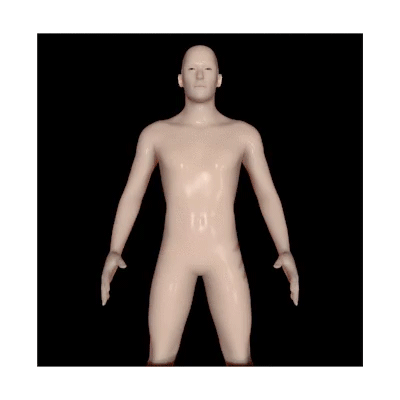

<h1> Hi, Kristoff's here </h1></h2>
<!--  -->

<div align="center">

<br>
<br>
<p>
  Visitor count<br>
  
</p>

<a href="https://www.codewars.com/users/chrystalio" style="margin-bottom: 10px;">
    
</a>
<br>
</div>

## 👨🏻‍💻 About Me :
- ☁️ Google Cloud Certified Associate (ACE)
- 🏆 Bangkit Academy 2024 Distinction Graduate
- 💻 Fullstack Web Developer
- 🎓 Bachelor of Computer Science
- 📍 Batam, Indonesia 🇮🇩

<div align="center">

</div>
<br/>

## 📊 Activities :
<!-- Two column div -->
<div align="center">

<br>

<!--START_SECTION:waka-->

```python
From: 29 September 2021 - To: 30 October 2026

Total Time: 2,340 hrs 17 mins

Other              4,745 hrs 48 mins     ████████████████▓░░░░░░░░   66.97 %
PHP                962 hrs 33 mins       ███▒░░░░░░░░░░░░░░░░░░░░░   13.58 %
Blade Template     536 hrs 36 mins       ██░░░░░░░░░░░░░░░░░░░░░░░   07.57 %
HTML               158 hrs 56 mins       ▓░░░░░░░░░░░░░░░░░░░░░░░░   02.24 %
JavaScript         122 hrs 17 mins       ▒░░░░░░░░░░░░░░░░░░░░░░░░   01.73 %
Markdown           106 hrs 3 mins        ▒░░░░░░░░░░░░░░░░░░░░░░░░   01.50 %
TypeScript         89 hrs 27 mins        ▒░░░░░░░░░░░░░░░░░░░░░░░░   01.26 %
CSS                80 hrs 19 mins        ▒░░░░░░░░░░░░░░░░░░░░░░░░   01.13 %
Python             55 hrs 26 mins        ▒░░░░░░░░░░░░░░░░░░░░░░░░   00.78 %
Text               42 hrs                ░░░░░░░░░░░░░░░░░░░░░░░░░   00.59 %
```

<!--END_SECTION:waka-->

<br>

[](https://holopin.io/@chrystalio)
